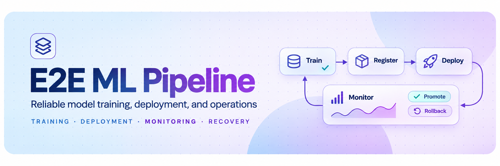

<div align="center">



### Reliable Model Deployment and Recovery

**A failure-aware ML platform that validates model artifacts, controls deployment transitions, monitors inference health, and automatically restores the last known-good model.**

Python · FastAPI · scikit-learn · DVC · MLflow · skops · Docker · Prometheus · pytest · Ruff · mypy

[](https://github.com/hydrangeas20/e2e-ml-pipeline/actions/workflows/ci.yml)

[Start here](#start-here) · [Demonstration](#demonstration) · [Evidence](#evidence) · [Architecture](#architecture) · [Model lifecycle](#model-lifecycle) · [Serving API](#serving-api) · [Reliability](#reliability) · [Quick start](#quick-start) · [Limitations](#limitations) · [Docs](#docs)

</div>

---

## Start here

**The problem.** Training a model is the easy part. The hard part is replacing the model in a live service without making things worse, which means answering four questions:
- Is the new artifact the one that was produced?
- Is it safe to load?
- Does it accept the inputs the service sends?
- Does it still work once real traffic hits it?

And when the answer to the last one is no, the service must return to a model that worked without anyone being paged.

**What this project does.** It started as a DVC + MLflow pipeline that trains a random-forest classifier on the public Pima diabetes dataset and serves it from FastAPI. Platform 2.0 (`mlpipe/`) adds the deployment lifecycle around that model:

1. **Package.** Every model becomes a versioned [skops](https://skops.readthedocs.io/) artifact with a sha256 and a manifest recording its feature schema, training data hash, parameters, metrics and provenance. The serving path never loads pickle.
2. **Validate.** Eight ordered checks run before a candidate can serve: integrity, metadata, declared schema, safe load, actual model features, prediction contract, numerical validity, resources.
3. **Promote.** An atomic in-memory swap, recorded in a fsync'd registry with an enforced state machine and a single-active invariant.
4. **Watch.** The promoted model is on **probation**: a health gate counts its errors, consecutive failures and p95 latency.
5. **Recover.** If the gate trips, the previous model, still loaded in memory, is restored immediately and the event is recorded. The same restore happens if the process dies mid-probation.

> **Scope.** This is a single-host MVP: one serving process per registry, enforced. Probation sends 100% of traffic to the candidate. There is **no traffic-split canary**. The model is an educational classifier on a public dataset; it is **not clinically validated** and must not be used for medical decisions. See [Limitations](#limitations).

**Suggested reading path:** [Demonstration](#demonstration) → [Evidence](#evidence) → [Model lifecycle](#model-lifecycle) → [`docs/PLATFORM.md`](docs/PLATFORM.md) → [`docs/REVIEW.md`](docs/REVIEW.md).

---

## Demonstration

`make demo` starts a real uvicorn server and drives it over HTTP. Every line is an assertion on an HTTP response or on persisted registry state; the command exits non-zero if any fails.

The candidate `v2-rf` is a deployment-testing fixture, trained on the legacy holdout split. It exists to exercise promotion and rollback; it is not a validated production model.

Excerpt of actual output:

```text
== 4. pre-promotion rejection of invalid candidates
  PASS  bad-corrupted rejected: integrity: sha256 8369d2101142 != manifest
  PASS  bad-schema-mismatch rejected: schema_compatibility: artifact schema gdm-features/2 (2e5e81eb6afe) != serving gdm-features/1 (8b4dea3147e6)
  PASS  bad-lying-schema rejected: model_features: model expects ['Pregnancies', 'Glucose', 'BloodPressure', 'SkinThickness', 'BMI', 'DiabetesPedigreeFunction', 'Age']
  PASS  bad-nan-output rejected: numerical_validity: non-finite probabilities
  PASS  bad-load-failure rejected: load: load_failed: unreadable skops archive: BadZipFile
        (after each: active model undisturbed, inference still 200 from v1-legacy-rf)

== 5. promote a valid candidate (atomic reference swap, probation starts)
  PASS  promotion with a stale generation is refused (409)
  PASS  v2-rf promoted: {'result': 'active_on_probation', 'previous': 'v1-legacy-rf', 'known_good': 'v1-legacy-rf', ...}

== 6. inject a post-promotion failure: v2-rf errors after 3 more requests
  observed (status, model_version): [(200, 'v2-rf'), (200, 'v2-rf'), (200, 'v2-rf'),
                                     (500, 'v2-rf'), (500, 'v2-rf'), (500, 'v2-rf'), (200, 'v1-legacy-rf')]

== 7-8. detection, automatic restore, inference after recovery
  PASS  active=v1-legacy-rf, probation cleared
  PASS  v2-rf persisted as rolled_back
  PASS  predict -> 200 from v1-legacy-rf
  PASS  second (manual) rollback is an idempotent no-op
  PASS  rolled-back version cannot be re-promoted (409)

== 9. deployment events
  gen= 17 promote   v2-rf   candidate -> active
  gen= 18 rollback  v2-rf   active -> rolled_back   health_gate error rate 0.273 > 0.2 over 11
  PASS  exactly one rollback event: trigger=health_gate, recovery_result=verified

== 10. graceful shutdown
  PASS  server drained and shut down via lifespan on SIGTERM
  PASS  32 audit records, each attributed to a model version

DEMO PASSED
```

The demo uses a tighter gate than the defaults (10 samples, 20% error rate) so it finishes quickly. The fault is injected deterministically (`error_after_n`) through an opt-in admin endpoint that is disabled by default.

---

## Evidence

| What | Result |
|---|---|
| `make check` (ruff, `mypy --strict`, pytest) | **149 passed, 0 skipped**, on Python 3.12 locally and in CI on 3.12 and 3.13 |
| `make demo` (real uvicorn process) | **27/27** assertions |
| `make docker-smoke` | container healthy, runs as uid 10001, rejects bad input with 422, drains on stop |
| Reliability review | 12 defects found and fixed (R1–R12). Each has a regression test that fails on the pre-review commit and passes now ([`docs/REVIEW.md`](docs/REVIEW.md)) |
| Crash recovery | 12 tests kill a real process (`os._exit`) at named transaction boundaries, including a uvicorn server mid-rollback, then restart from disk |
| Legacy parity | the migrated model returns the same prediction and confidence as the original pickle code, and reproduces the MLflow-logged metrics exactly |

**Test suite by area:**

| Area | Tests | File |
|---|---|---|
| Artifacts, integrity, safe loading, legacy parity | 7 | `tests/test_artifacts.py` |
| Validation fixtures, state machine, registry | 15 | `tests/test_validation_registry.py` |
| Serving contract, health, metrics, logging | 17 | `tests/test_serving_contract.py` |
| `/predict` vs `/v1/predict` input rules | 22 | `tests/test_api_compat.py` |
| Promotion, rollback, restart, concurrency | 17 | `tests/test_rollout.py` |
| Health gate policy, request attribution under concurrency | 21 | `tests/test_gate_concurrency.py` |
| Crash recovery (subprocess, real server) | 12 | `tests/test_crash_recovery.py` |
| Review regressions R1–R12 | 12 | `tests/test_review_regressions.py` |
| Fault injection, configuration, shutdown, diagnosis | 23 | `tests/test_faults_diagnose.py` |
| CLI lifecycle and the full demo | 2 | `tests/test_cli_e2e.py` |
| Declared Python support matches the CI matrix | 1 | `tests/test_packaging.py` |

What this evidence does **not** cover: multi-host deployment, power loss, adversarial artifact authors (there is no signing), and the predictive quality of any new model.

---

## Architecture

A modular monolith: one package, one serving process, a filesystem registry.

```text
 offline (CLI)                         registry/ (filesystem)                     online (FastAPI process)
 ─────────────                         ──────────────────────                     ────────────────────────
 data ─► features ─► train ─► package ─► register ─► validate ───────────────────► promote ─► serve
         features.py  train.py artifacts.py  registry.py  validation.py             │            │
                                         │                                          │      health gate
                                         ├ models/<v>/{model.skops,manifest.json}   │            │
                                         ├ state.json   (atomic replace, fsync)  ◄──┴── rollback ◄┘
                                         ├ events.jsonl (append, fsync)
                                         └ .serve.lock  (one server per registry)
```

| Concern | Module |
|---|---|
| Feature contract (`gdm-features/1`) | `mlpipe/schema.py` |
| Shared train/serve transform | `mlpipe/features.py` |
| Packaging, integrity, safe loading | `mlpipe/artifacts.py` |
| Registry, state machine, event journal | `mlpipe/registry.py` |
| Candidate validation | `mlpipe/validation.py` |
| Promotion, probation, rollback, restart recovery | `mlpipe/serving/deployment.py` |
| HTTP API, admission, timeouts, audit | `mlpipe/serving/app.py` (entry point `app/main.py`) |
| Metrics, JSON logs, request IDs | `mlpipe/serving/observability.py` |
| Opt-in fault injection | `mlpipe/serving/faults.py`, `mlpipe/crash.py` |
| Layered model-quality diagnosis | `mlpipe/diagnose.py` |
| CLI and demo | `mlpipe/cli.py`, `mlpipe/demo.py` |

**Why this shape works:**
- **One process holds the active model.** That makes the swap a single reference assignment, so a response can never mix two models.
- **The known-good model stays loaded during probation.** Rollback is therefore a swap that cannot fail on disk or deserialization.
- **Durable state is written in a fixed order:** journal (fsync) → `state.json` (atomic) → memory. Rollback is the exception: memory moves first, so a failing disk cannot keep a bad model in service. Every tested crash boundary recovers on restart, except two that deliberately fail closed (see the [crash matrix](docs/REVIEW.md#3-crash-recovery-matrix-teststest_crash_recoverypy)).

<details>
<summary>Repository layout</summary>

```text
app/main.py                 entry point (uvicorn app.main:app)
mlpipe/                     platform package (see table above)
mlpipe/data/smoke.csv       rows used for validation smoke inference
tests/                      149 tests, incl. crash harness
docs/PLATFORM.md            architecture, guarantees, runbook
docs/REVIEW.md              reliability review: findings, crash matrix, API decisions
scripts/docker_smoke.sh     container smoke test
requirements/*.lock         hash-pinned dependencies (serve, dev)
Dockerfile, Makefile, .github/workflows/ci.yml
src/, dvc.yaml, params.yaml original DVC pipeline (preprocess -> train -> evaluate)
mlruns/, mlflow.db          original MLflow runs, including the pinned legacy model
data/splits/test.csv        committed holdout split (154 rows)
```

</details>

---

## Model lifecycle

```text
registered ──► validated ──► candidate ──► active ──► retired ──► active   (rollback target)
     │             │             │            │
     └► rejected ◄─┴─────────────┘            └► rolled_back
```

| Rule | Enforcement |
|---|---|
| Exactly one version is `active`, and it is the `active` pointer | `Registry.check_invariants` runs before every commit |
| Only listed transitions are allowed; `rejected` and `rolled_back` are terminal | `registry.TRANSITIONS` |
| Bytes are re-verified at promotion time, not only at registration | `validate_artifact` re-runs on `candidate` |
| Known-bad bytes cannot return under a new version name | sha256 compared with every rejected / rolled-back version |
| Stale writers are refused | `expected_generation` → 409 |
| Interrupted promotions are recoverable | leftover `candidate` released on restart; a commit that landed despite an error is completed |
| Journal and state stay consistent | generations are never reused; aborted ones are listed as uncommitted |

**Probation gate** (defaults; set with `MLPIPE_GATE_*`):

| Rule | Default |
|---|---|
| Fail on consecutive failures, at any sample count | 5 |
| Fail on error rate, once `min_samples` outcomes exist | > 10% after 20 |
| Fail on p95 latency of successful requests | > 250 ms after 20 |
| Pass (candidate becomes known-good) | 100 outcomes without failing |

Counted as candidate failures: model errors, invalid outputs, feature-pipeline errors, timeouts. **Not** counted: 422 input errors, 429 admission refusals, audit-log failures, and late results from a model that is no longer on probation. The gate measures serving health only; it says nothing about predictive quality, which needs labels (`mlpipe diagnose`).

---

## Serving API

| Endpoint | Purpose |
|---|---|
| `POST /v1/predict` | Batch inference, strictly typed: `{"instances": [{...}, ...]}` (1–64 rows) |
| `POST /predict` | **Deprecated** original flat payload; no removal date set |
| `GET /livez` | Process is alive |
| `GET /readyz` (alias `/health`) | Model loaded, artifact still matches its hash, registry readable, not draining |
| `GET /metrics` | Prometheus metrics |
| `GET /` | Original `{"status": "ok"}` |
| `/admin/*` | Deployment state, events, validate, promote, rollback, faults. Needs `Authorization: Bearer $MLPIPE_ADMIN_TOKEN`; disabled (403) when no token is set |

```bash
curl -s -X POST localhost:8000/v1/predict -H 'content-type: application/json' -H 'X-Request-ID: readme-1' \
  -d '{"instances":[{"Pregnancies":4,"Glucose":148,"BloodPressure":72,"SkinThickness":35,"Insulin":0,"BMI":28.0,"DiabetesPedigreeFunction":0.627,"Age":50}]}'
```

```json
{
  "request_id": "readme-1",
  "model_version": "v1-legacy-rf",
  "model_sha256": "4cf33ad78e61d71c2d315ceb4635b013e5ba3ddb1331023babad2168d1864f0e",
  "schema_version": "gdm-features/1",
  "config_version": "99774bab623733c2",
  "decision_threshold": 0.5,
  "predictions": [{"prediction": 1, "probability": 0.764779392519846}]
}
```

Every prediction is traceable to its model version, model sha256, schema version and configuration hash. The same fields are written to the prediction audit log (no feature values).

**Input rules** (both routes share one schema and its bounds):

| Integer feature value | `/predict` (deprecated) | `/v1/predict` |
|---|---|---|
| `148` | 200 | 200 |
| `148.0`, `1e2` (exact-integer float) | 200, treated as the integer | 422 |
| `148.5`, `"148"`, `true`, `null` | 422 | 422 |
| NaN, ±Infinity, out of range | 422 | 422 |
| unknown or missing feature | 422 | 422 |

Errors use one shape, `{"error": {"code", "message", "request_id", "details"}}`. Validation errors report field locations, never the submitted values.

---

## Reliability

| Failure | What happens | Evidence |
|---|---|---|
| Corrupted, mis-schemaed, unloadable or NaN-producing artifact | rejected before promotion; active model untouched | demo step 4; `test_rollout.py` |
| Candidate fails after promotion | gate trips → known-good restored from memory → event recorded | demo steps 6–8 |
| Process dies during probation, or mid-rollback | restart restores known-good (`restart_during_probation`) | `test_crash_recovery.py` |
| Known-good artifact missing during probation | **fails closed**: 503 with an operational reason; candidate not served; probation kept on disk for manual recovery | `test_r1_…`, `test_missing_known_good_…` |
| Rollback cannot be written to disk | known-good keeps serving; `/readyz` reports `degraded`; promotions refused until reconciled | `test_r2_…` |
| Overload | 429 beyond `max_concurrency + max_queue` (default 4 + 16) | `test_overload_is_refused_at_admission` |
| Slow inference | 504 after `request_timeout_s`; the result is discarded, not audited and not counted (see [Limitations](#limitations)) | `test_r4_…` |
| Second server on the same registry | refused at startup (serving lock) | `test_r5_…` |
| Audit log unwritable | 503; no prediction is returned without its audit record | `test_required_audit_failure_withholds_prediction` |
| SIGTERM | readiness off, in-flight requests drained, clean shutdown | demo step 10 |

**Security boundaries:**

| Property | Status |
|---|---|
| No arbitrary code on model load | **demonstrated**: skops with a one-entry type allowlist (`sklearn.tree._tree.Tree`); smuggled callables refused (`test_untrusted_types_are_refused_not_loaded`). Relies on skops' default trusted set. |
| Corruption / tampering detected | **demonstrated**: sha256 checked before load and on every `/readyz`. This is integrity, not authenticity: whoever can write the registry can forge a matching pair. |
| Paths stay inside the registry | **demonstrated**: version names are regex-restricted; symlinked artifacts and directories refused |
| Admin endpoints | bearer token, constant-time comparison; disabled without a token. **Assumption:** TLS and network isolation come from the deployment. |
| Logs | JSON, with request IDs; feature values are not logged or echoed in errors (tested) |
| Container | non-root (uid 10001), HEALTHCHECK on `/readyz`, fault injection off, dependencies installed from a hash-pinned lock |

Runbook entries for latency spikes, error spikes, load failures, degraded state, fail-closed startup and the serving lock are in [`docs/PLATFORM.md` §5](docs/PLATFORM.md#5-observability).

---

## Quick start

Requires Python 3.12 or newer (`requires-python >=3.12`); CI tests 3.12 and 3.13.

```bash
python3.12 -m venv .venv && . .venv/bin/activate
make install                 # requirements/dev.lock (hash-pinned) + editable install
make check                   # ruff, mypy --strict, 149 tests (~2.5 min)
make demo                    # rollout -> injected failure -> automatic rollback
```

**Serve the migrated legacy model and run a rollout yourself:**

```bash
make prepare                                            # legacy pickle -> skops v1-legacy-rf, bootstrapped
export MLPIPE_ADMIN_TOKEN=$(openssl rand -hex 16)
make serve &                                            # http://127.0.0.1:8000
mlpipe train --data data/splits/test.csv --version v2-rf  # a deployment-testing fixture
mlpipe promote v2-rf                                    # active_on_probation
mlpipe predict -n 2                                     # served by v2-rf
mlpipe rollback --reason "trying it out"                # back to v1-legacy-rf
mlpipe events --limit 5
```

**Docker:**

```bash
docker build -t mlpipe .
docker run -d --name mlpipe -p 8000:8000 -v mlpipe-data:/var/lib/mlpipe \
  -e MLPIPE_ADMIN_TOKEN=$(openssl rand -hex 16) mlpipe
docker exec mlpipe mlpipe state
make docker-smoke                                       # build, run, verify, stop
```

The image ships with `v1-legacy-rf` bootstrapped. Use a **named volume**: Docker initializes it from the image. An empty bind mount starts unready (`no active model`). Train, promote and restart inside the container as described in [`docs/PLATFORM.md` §10](docs/PLATFORM.md#10-docker-operations).

<details>
<summary>Original DVC / MLflow workflow</summary>

The original pipeline is unchanged: `preprocess → train (GridSearchCV over a random forest) → evaluate`, with experiment tracking in MLflow.

```bash
pip install -r requirements.txt   # legacy environment (DVC, MLflow, DagsHub)
dvc pull                          # needs DagsHub credentials for data/raw/data.csv
dvc repro
```

Credentials for the MLflow/DagsHub remote go in a local `.env` (ignored by git).


**Dataset:** the Pima Indians Diabetes dataset (768 rows). Features: Pregnancies, Glucose, BloodPressure, SkinThickness, Insulin, BMI, DiabetesPedigreeFunction, Age. Target: `Outcome` (1 = diabetes positive). Public copy: [diabetes.csv](https://github.com/maghfera/Diabetes-prediction/blob/main/diabetes.csv). Zeros encode missing measurements in several columns; `mlpipe diagnose` flags this.

</details>

---

## Limitations

| Limitation | Status |
|---|---|
| **One serving process per registry, one host.** Enforced locally by a lock; not safe on shared network filesystems. | Accepted (architecture) |
| **No canary.** Probation sends 100% of traffic to the candidate; the gate bounds exposure (5 consecutive failures by default). | Accepted |
| **Timeouts don't cancel work.** A 504'd computation finishes in its thread, holding its admission slot, so capacity stays bounded. Hard cancellation needs process-isolated workers. | Accepted |
| **No artifact signatures.** sha256 gives integrity, not authenticity. | Future work |
| **Probation has no time limit.** With no traffic it never ends and blocks further promotions; a restart rolls the candidate back. | Future work |
| **Coarse small-sample gate.** At 20 samples one error is worth 5 percentage points. | Future work |
| **Crash just after the rollback swap** records the committed reason as `restart_during_probation`, not `health_gate`. | Future work |
| **Original training is not reproducible.** The raw data lives only on the DagsHub DVC remote, and the committed `src/train.py` is not the version pinned in `dvc.lock`. Serving, artifacts and legacy evaluation *are* reproducible. | Cannot be fixed without the historical inputs |
| **Not a validated clinical model.** Models trained by the demo or tests are deployment-testing fixtures. | By design |

Full detail, with source locations: [`docs/REVIEW.md`](docs/REVIEW.md).

---

## Docs

| Document | Contents |
|---|---|
| [`docs/PLATFORM.md`](docs/PLATFORM.md) | Architecture, state machine, promotion and rollback, serving, metrics, runbook, configuration, data provenance, Docker operations |
| [`docs/REVIEW.md`](docs/REVIEW.md) | Reliability review: findings R1–R12 with source locations, state-transition and crash-recovery matrices, gate behaviour, API compatibility decisions, reproducibility split |
| [`.github/workflows/ci.yml`](.github/workflows/ci.yml) | CI: lint, types, tests and demo on 3.12 and 3.13; Docker build and smoke |
